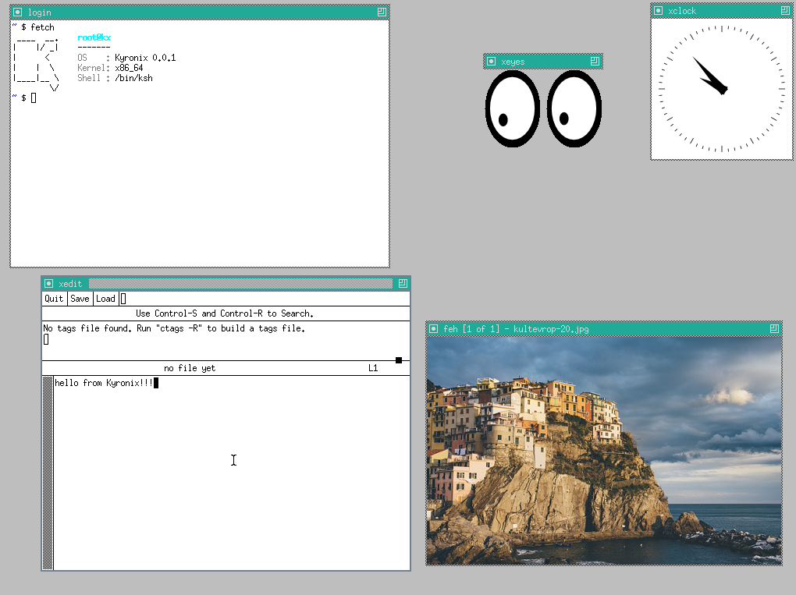

# Kyronix


Minimalist x86-64 operating system that sucks less.


[](https://github.com/kyronix-project/kyronix/actions/workflows/test.yml)
[](LICENSE)
[](#)

<br clear="left"/>

|  |
| :---: |

## Building & Running

Build using a container runtime (`podman` or `docker`):

```sh
make CRUNTIME=podman -j $(nproc)
```

and run: 
```sh
make run
```

## License
ISC License. See [LICENSE](./LICENSE) for details.